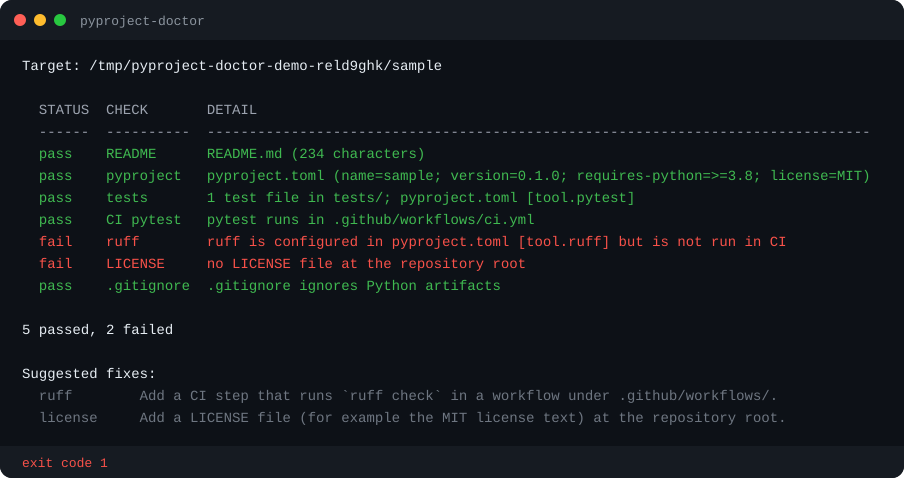

# pyproject-doctor

Zero-dependency CLI that checks small Python repositories for a README, a complete `pyproject.toml`, tests, ruff/pytest CI, a LICENSE file, and a Python `.gitignore`, and prints a one-line fix for each failing check.

[](.github/workflows/ci.yml)
[](https://www.python.org/downloads/)
[](LICENSE)

It only reads a local directory or the public GitHub API (optional `GITHUB_TOKEN`). There are no runtime dependencies.

**中文简介：** pyproject-doctor 是一个零依赖的命令行工具，用来检查小型 Python 仓库是否具备 README、完整的 `pyproject.toml`、测试、会运行 ruff 与 pytest 的 GitHub Actions、LICENSE，以及会忽略 Python 缓存的 `.gitignore`。每一项失败都会附带一行修复建议。它只读取本地目录，或通过公开的 GitHub API 读取远程仓库（可选环境变量 `GITHUB_TOKEN`）。

## Demo

Real run of the installed `pyproject-doctor` CLI. [`docs/generate_demo.py`](docs/generate_demo.py) built a temporary sample repository (README, `pyproject.toml` with ruff and pytest configuration, tests, a Python `.gitignore`, and a GitHub Actions workflow that runs pytest but not ruff; no LICENSE file), ran the CLI on it, and saved the stdout and exit code. This run exited `1`: 5 checks passed and 2 failed (`ruff` is configured but not run in CI, and there is no LICENSE file).



The same capture, including the command, exit code, and verbatim stdout, is in [`docs/demo.txt`](docs/demo.txt).

## Why this exists

Small personal Python repos tend to miss the same hygiene basics. This gives a fast checklist with one-line fixes.

## Install

This project is **not** published on PyPI. The PyPI name [`pyproject-doctor`](https://pypi.org/project/pyproject-doctor/) belongs to a different project: an offline semantic validator for `pyproject.toml` ([amaar-mc/pyproject-doctor](https://github.com/amaar-mc/pyproject-doctor)). `pip install pyproject-doctor` installs that other package.

Install this repository from Git:

```bash
pip install git+https://github.com/Master-626/pyproject-doctor.git
```

Or from a clone:

```bash
pip install .
```

Python 3.8 or newer is required.

## Quick start

```bash
pip install git+https://github.com/Master-626/pyproject-doctor.git
pyproject-doctor
```

That scans the current directory and prints a pass or fail line for each check, then a one-line fix for every failure.

## Usage

```bash
# Scan the current directory
pyproject-doctor

# Scan a local path
pyproject-doctor path/to/repo

# Scan a public GitHub repository (no token required)
pyproject-doctor --github Master-626/pyproject-doctor

# Machine-readable output
pyproject-doctor --json

# Exit 0 when at least 6 of the 7 checks pass
pyproject-doctor --fail-under 6
```

Set `GITHUB_TOKEN` (or `GH_TOKEN`) if you hit the unauthenticated GitHub API rate limit.

The process exits with code `1` when any check fails, or when fewer than `N` checks pass if you set `--fail-under N`. Passing `--strict` also exits `1` when any check fails; that is already the default when `--fail-under` is not set. Usage and network errors exit with code `2`.

`--json` prints the same report as a JSON object with `target`, `passed`, `failed`, `total`, `ok`, and a `checks` array (`id`, `name`, `status`, `detail`, `fix`).

## Checks

| Check | Passes when |
| --- | --- |
| `readme` | A README exists at the repo root and is more than a title |
| `pyproject` | `pyproject.toml` has `[project]` `name`, `version` (or `dynamic = ["version"]`), `requires-python`, and `license` (or `license-files`) |
| `tests` | At least one `test_*.py` / `*_test.py` file is present |
| `ci_pytest` | A workflow file directly in `.github/workflows/` runs `pytest` |
| `ruff` | Ruff is configured (`[tool.ruff]`, `ruff.toml`, or `.ruff.toml`) and a workflow file directly in `.github/workflows/` runs it |
| `license` | A `LICENSE` (or `LICENCE` / `COPYING`) file exists at the repo root |
| `gitignore` | A root `.gitignore` ignores Python bytecode, a virtualenv, egg-info, or a tool cache such as `.pytest_cache` |

## Development

```bash
pip install -e ".[dev]"
ruff check .
pytest
python docs/generate_demo.py
```

`docs/generate_demo.py` rewrites `docs/demo.txt` and `docs/demo.svg` from a new CLI run. The package has no runtime dependencies. On Python 3.11 and newer, TOML is parsed with the standard library. Python 3.8-3.10 use the fallback parser in `src/pyproject_doctor/toml_util.py`.

## License

MIT
